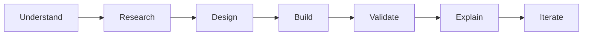

# ADISHREE GUPTA
**Software Engineer · AI/ML Engineer · Research Engineer · Full-Stack Developer · Cybersecurity & Data Systems**

*Turning difficult ideas into researched, explainable and usable systems.*

**B.Tech CSE · PES University, Bengaluru · Research & Engineering Portfolio**

---

## ⚡ 10-second recruiter snapshot

| I build | I investigate | I make usable |
|:--:|:--:|:--:|
| **Full-stack apps · APIs · Data pipelines** | **ML · Vision · Security · Research** | **Demos · Dashboards · Human-centered systems** |
| [Software & backend](docs/ROLE_PATHWAYS.md) | [Research & AI](docs/ROLE_PATHWAYS.md) | [Product & interfaces](docs/ROLE_PATHWAYS.md) |

### 🧭 My engineering identities

---

## 🌌 Enter the project worlds

*Eight different problem domains. Click any animated card to open real project code, documentation and experiments.*

<table>
<tr>
<td width="50%"></td>
<td width="50%"></td>
</tr>
<tr>
<td></td>
<td></td>
</tr>
<tr>
<td></td>
<td></td>
</tr>
<tr>
<td></td>
<td></td>
</tr>
</table>

**[Explore all 104 public repositories by domain →](docs/PROJECT_DIRECTORY.md)** · **[Follow role-based project trails →](docs/ROLE_PATHWAYS.md)** · **[Read engineering walkthroughs →](docs/PROJECT_SPOTLIGHTS.md)**

---

## 💻 Languages I use — individually named

**Programming & querying**

**Web & styling**

**Scripting, documentation & configuration formats**

**Frameworks, tools & systems**

---

## 🌆 Actual 3D contributions

---

## 🧠 How I work — in one view

## 📚 Research & recognition

**Research:** [Google Scholar publications](https://scholar.google.com/citations?user=NAn0PqcAAAAJ&hl=en) · Multimodal intelligence · Cyber-physical systems · Security analytics

**Recognition:** National Girls Hackathon runner-up · TechGig Geek Goddess AIR 113 · SBI Youth Ideathon Top 1000 · EY GDS Certificate of Merit · GHCI Advancing Inclusion Scholar

---

### Explore the engineering. Follow the evidence.

[**All public projects**](docs/PROJECT_DIRECTORY.md) · [**Role pathways**](docs/ROLE_PATHWAYS.md) · [**LinkedIn**](https://www.linkedin.com/in/adishreegupta/) · [**Google Scholar**](https://scholar.google.com/citations?user=NAn0PqcAAAAJ&hl=en) · [**Email**](mailto:adishreegupta@gmail.com)

