

# ADISHREE GUPTA
**Software Engineer · AI/ML Engineer · Research Engineer · Full-Stack Developer · Cybersecurity & Data Systems**

*Turning difficult ideas into researched, explainable and usable systems.*


**B.Tech CSE · PES University, Bengaluru · Research & Engineering Portfolio**

---

## ⚡ At a glance

| I build | I investigate | I make usable |
|:--:|:--:|:--:|
| **Full-stack apps · APIs · Data pipelines** | **ML · Vision · Security · Research** | **Demos · Dashboards · Human-centered systems** |
| [Software & backend](docs/ROLE_PATHWAYS.md) | [Research & AI](docs/ROLE_PATHWAYS.md) | [Product & interfaces](docs/ROLE_PATHWAYS.md) |

### 🧭 Explore my engineering disciplines

Click any 3D role card to open source-backed project evidence.

<table><tr><td width="33%"><a href="docs/roles/software-engineer.md"></a></td><td width="33%"><a href="docs/roles/full-stack.md"></a></td><td width="33%"><a href="docs/roles/backend.md"></a></td></tr>
<tr><td width="33%"><a href="docs/roles/ai-ml.md"></a></td><td width="33%"><a href="docs/roles/research.md"></a></td><td width="33%"><a href="docs/roles/data-science.md"></a></td></tr>
<tr><td width="33%"><a href="docs/roles/computer-vision.md"></a></td><td width="33%"><a href="docs/roles/cybersecurity.md"></a></td><td width="33%"><a href="docs/roles/cloud-devops.md"></a></td></tr>
<tr><td width="33%"><a href="docs/roles/mobile-apps.md"></a></td><td width="33%"><a href="docs/roles/technical-product.md"></a></td></tr></table>

---

## 🌍 Engineering across domains

**Different industries. The same curiosity, systems thinking and discipline to learn what each problem requires.** My work spans finance, health, mobility, security, agriculture, sustainability, visual intelligence, retail, mission systems and accessibility. Explore the implemented examples—not an assumption that every domain uses the same solution.

<table>
<tr><td width="50%"></td><td width="50%"><a href="docs/domains/healthtech.md">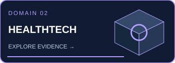</a></td></tr>
<tr><td width="50%"><a href="docs/domains/mobility.md">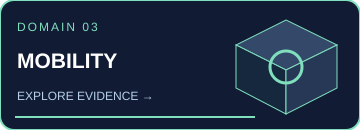</a></td><td width="50%"><a href="docs/domains/cybersecurity.md">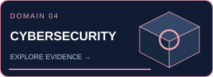</a></td></tr>
<tr><td width="50%"><a href="docs/domains/computer-vision.md">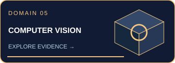</a></td><td width="50%"><a href="docs/domains/agriculture.md">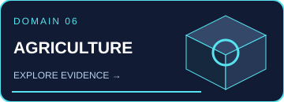</a></td></tr>
<tr><td width="50%"><a href="docs/domains/sustainability.md">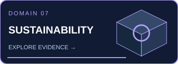</a></td><td width="50%"><a href="docs/domains/retail-analytics.md">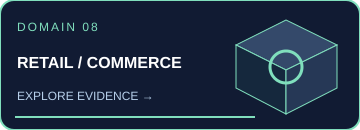</a></td></tr>
<tr><td width="50%"><a href="docs/domains/mission-systems.md">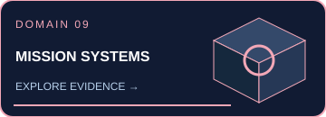</a></td><td width="50%"><a href="docs/domains/accessibility.md">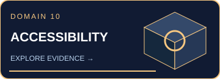</a></td></tr>
</table>

[**Open the complete domain atlas →**](docs/DOMAIN_ATLAS.md)

---

## 🌌 Enter the project worlds

*Eight different problem domains. Click any animated card to open real project code, documentation and experiments.*

<table>
<tr>
<td width="50%"><a href="https://github.com/1stsimplifycode/BSERC---Chronos-AEGIS-A-Cognitive-Mission-Console">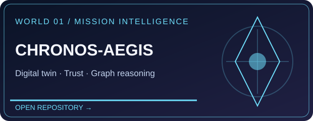</a></td>
<td width="50%"><a href="https://github.com/1stsimplifycode/JourneyMind">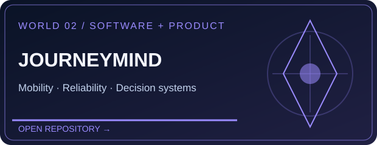</a></td>
</tr>
<tr>
<td><a href="https://github.com/1stsimplifycode/Amazon-ML">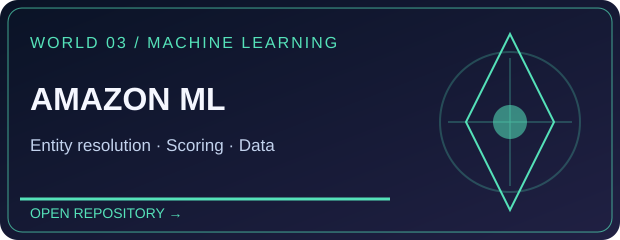</a></td>
<td><a href="https://github.com/1stsimplifycode/ClearCare-Understand-My-Care-Instructions">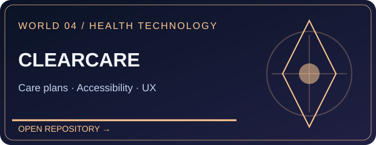</a></td>
</tr>
<tr>
<td><a href="https://github.com/1stsimplifycode/identity-threat-detection-platform">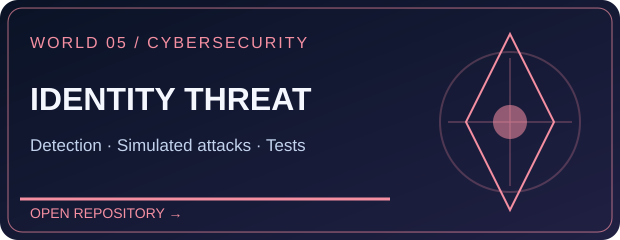</a></td>
<td><a href="https://github.com/1stsimplifycode/CamSketch">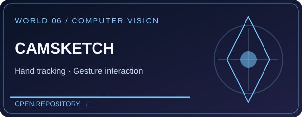</a></td>
</tr>
<tr>
<td><a href="https://github.com/1stsimplifycode/AEGIS_MULTIMODAL">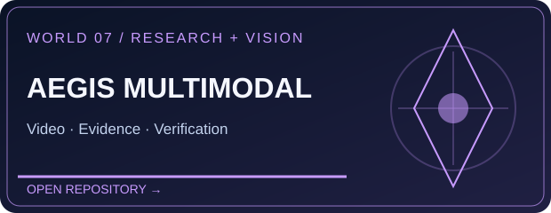</a></td>
<td><a href="https://github.com/1stsimplifycode/Rice_Production_Forecasting_India">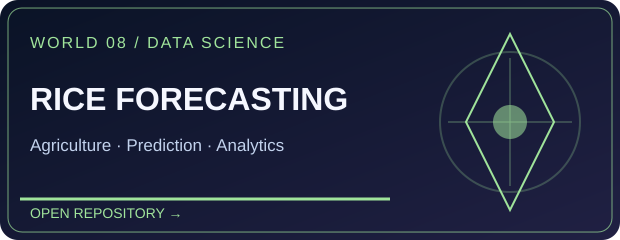</a></td>
</tr>
</table>

**[Explore the public project directory →](docs/PROJECT_DIRECTORY.md)** · **[Follow role-based project trails →](docs/ROLE_PATHWAYS.md)** · **[Read engineering walkthroughs →](docs/PROJECT_SPOTLIGHTS.md)**

---

## 💻 Languages I use — individually named

**Programming & querying**

**Web & styling**

**Scripting, documentation & configuration formats**

**Frameworks, tools & systems**

---

## 🌆 Actual 3D contributions

---

## 🧠 How I work — a 3D engineering lifecycle


**Click evidence behind the lifecycle:** [Problem framing and product trade-offs — JourneyMind](https://github.com/1stsimplifycode/JourneyMind) · [Research and reproducibility — Chronos-AEGIS](https://github.com/1stsimplifycode/BSERC---Chronos-AEGIS-A-Cognitive-Mission-Console) · [Data and evaluation — Amazon ML](https://github.com/1stsimplifycode/Amazon-ML) · [Safety and user experience — ClearCare](https://github.com/1stsimplifycode/ClearCare-Understand-My-Care-Instructions) · [Security testing — Identity Threat Detection](https://github.com/1stsimplifycode/identity-threat-detection-platform)

Every role badge above is a clickable path to a dedicated evidence page. The engineering lifecycle illustrates my approach; project links provide examples to inspect.

## 📚 Research & recognition

**Research:** [Google Scholar publications](https://scholar.google.com/citations?user=NAn0PqcAAAAJ&hl=en) · Multimodal intelligence · Cyber-physical systems · Security analytics

**Recognition:** National Girls Hackathon runner-up · TechGig Geek Goddess AIR 113 · SBI Youth Ideathon Top 1000 · EY GDS Certificate of Merit · GHCI Advancing Inclusion Scholar

---

### Explore the engineering. Follow the evidence.

[**All public projects**](docs/PROJECT_DIRECTORY.md) · [**Role pathways**](docs/ROLE_PATHWAYS.md) · [**LinkedIn**](https://www.linkedin.com/in/adishreegupta/) · [**Google Scholar**](https://scholar.google.com/citations?user=NAn0PqcAAAAJ&hl=en) · [**Email**](mailto:adishreegupta@gmail.com)

