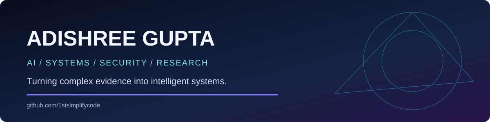

### AI/ML Engineering · Software Engineering · Cybersecurity · Applied Research

**I engineer systems that turn uncertain, complex data into useful, explainable decisions.**

---

## 👩‍💻 About me

I'm a Computer Science undergraduate at **PES University, Bengaluru**, interested in building reliable AI applications, software systems, and security-focused technology. My projects span **multimodal machine learning, full-stack development, computer vision, real-time systems, and cybersecurity**.

My goal is to connect rigorous research and engineering with applications that solve practical problems.

## 🎯 Engineering problems I like solving

| Challenge | My approach |
| --- | --- |
| Fragmented information and weak decision context | Combine evidence from different sources and make outputs interpretable |
| Models that fail on edge cases | Evaluate robustness, compare baselines, and test failure modes |
| Security signals buried in noise | Build detection pipelines and meaningful alerts |
| Research prototypes that are difficult to use | Bridge algorithms, APIs, deployment, and accessible interfaces |

## 🚀 Featured projects

### 📊 AEGIS Market Risk Intelligence
A multimodal market-risk intelligence project combining **price/volume, news, television, and social evidence** in an explainable decision workflow. Engineering themes include event-time evidence, feature pipelines, OCR, evaluation, and user-facing interfaces.

**[Explore AEGIS repository →](https://github.com/1stsimplifycode/CAPSTONE-PW26_SSS_08)**

### 🔐 Threat Detection System
A real-time DoS detection system using **Snort, Flask, and Wazuh**, demonstrating security event monitoring and application integration.

### 🛒 ShopConnect
A **MERN-stack** application connecting local shops and users. Prior project documentation reports support for 1,000+ concurrent users and a 30% latency reduction; see the original project for measurement context.

### 🏏 Cricket Analyzer
Computer vision analysis of player performance using **OpenCV and TensorFlow**. Prior project documentation reports 95% accuracy; consult the associated evaluation for the metric definition.

### 🖥️ Touch-Free Laptop Control
An accessibility-first interface using **MediaPipe, gestures, and voice** for laptop interaction.

### 🚆 Train Delay Prediction System
A project exploring delay prediction through network and systems analysis, including TCP/IP-oriented tooling.

### ☁️ Secure AWS EC2 Deployment
Node.js threat detection deployment using **GitHub Actions, AWS CloudWatch, and CI/CD workflows**.

**[Browse every repository — nothing hidden or removed →](https://github.com/1stsimplifycode?tab=repositories)**

## 🧰 Technical toolkit

**Languages:** Python · Java · JavaScript · C++ · SQL  
**Full stack:** React · Node.js · Express · MongoDB · REST APIs  
**AI and computer vision:** scikit-learn · TensorFlow · OpenCV · MediaPipe  
**Security and systems:** Snort · Wazuh · Kali Linux · TCP/IP · Network Packet Analysis  
**Development and cloud:** Git · Docker · Unix/Linux · AWS IAM · GitHub Actions

## 📚 Research and publications

My research interests include **multimodal AI, evidence reliability, intelligent market systems, and security analytics**. See my author page for publication records and status.

[**View Google Scholar profile →**](https://scholar.google.com/citations?user=NAn0PqcAAAAJ&hl=en)

## 🏆 Awards and recognition

- 🥈 **1st Runner-Up** — National Girls Hackathon
- 👩‍💻 **AIR 113** — TechGig Geek Goddess
- 🧠 **Top 1000 Entrepreneurs** — SBI Youth Ideathon
- 🏅 **Certificate of Merit** — EY GDS Internship
- 🎓 **Scholar** — GHCI Advancing Inclusion

## 📜 Certifications

Google Cybersecurity (Coursera) · Google AI Essentials · Generative AI in Action · Communicating with Confidence · Learning Data Governance

## 💼 Where I can contribute

| Engineering path | Problems I can work on |
| --- | --- |
| Software / Backend Engineering | APIs, integrations, reliable application workflows |
| AI/ML Engineering | Data pipelines, evaluation, multimodal inference |
| Applied AI / Research Engineering | Reproducible experiments, robustness testing, algorithm prototypes |
| Cybersecurity Engineering | Threat detection, observability, security automation |
| Technical Product / Forward-Deployed Engineering | Translating user pain points into shipped prototypes |

## 🧭 Explore my work

- [**Browse the public project directory**](docs/PROJECT_DIRECTORY.md) — an indexed guide to public repositories
- [**Explore projects by engineering role**](docs/ROLE_PATHWAYS.md) — source links for different recruiting paths

## 📈 GitHub activity

---

**Build carefully · Test rigorously · Make it useful**

[LinkedIn](https://www.linkedin.com/in/adishreegupta/) · [Google Scholar](https://scholar.google.com/citations?user=NAn0PqcAAAAJ&hl=en) · [Email](mailto:adishreegupta@gmail.com) · [All repositories](https://github.com/1stsimplifycode?tab=repositories)

