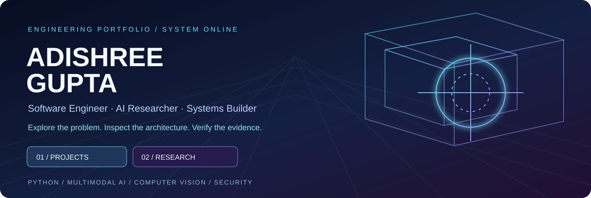
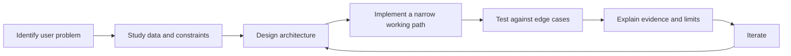

### Enter the engineering command deck

**Every project is a door: understand the problem → inspect its system → read its evidence → try the implementation.**

[**Explore projects**](docs/PROJECT_DIRECTORY.md) · [**Choose your engineering role**](docs/ROLE_PATHWAYS.md) · [**Research**](https://scholar.google.com/citations?user=NAn0PqcAAAAJ&hl=en) · [**LinkedIn**](https://www.linkedin.com/in/adishreegupta/) · [**Email**](mailto:adishreegupta@gmail.com)

---

## 00 / Navigation — choose your route

| Enter through | What you'll find | Where to go |
|---|---|---|
| **Build** | Applications, APIs, full-stack systems | [Project directory](docs/PROJECT_DIRECTORY.md) |
| **Investigate** | ML pipelines, experimental baselines and research artifacts | [Research repositories](https://github.com/1stsimplifycode?tab=repositories) |
| **Defend** | Security analytics, threat detection and system safeguards | [Role pathways](docs/ROLE_PATHWAYS.md) |
| **Evaluate** | Tests, claims, assumptions and reproducibility limits | [Evidence walkthroughs](docs/PROJECT_SPOTLIGHTS.md) |

## 01 / Who I am

I’m **Adishree Gupta**, a Computer Science engineering student at **PES University, Bengaluru**. I build and research software that operates under practical constraints: imperfect data, ambiguous signals, interfaces for real users, and the need to explain why a system reached a particular conclusion.

My public work spans **AI/ML, multimodal evidence, data science, computer vision, cybersecurity, full-stack apps, and research engineering**. I treat each implementation as something another engineer should be able to inspect—not just a screenshot.

> **What I offer an engineering team:** the ability to move between problem framing, prototypes, data pipelines, model evaluation, APIs and user-facing experiences. The repositories below are the evidence; they are not a claim of universal expertise.

## 01A / The roles I work across

I am not one single template. My work spans multiple connected engineering disciplines, with different levels of demonstrated depth. Explore the source before treating any title as a formal employment designation.

| Professional identity | Evidence from my projects | Explore |
|---|---|---|
| **Software Engineer / SDE** | Application implementations, algorithmic problem solving, Python and JavaScript | [Engineering pathway](docs/ROLE_PATHWAYS.md) |
| **Full-Stack Developer** | Frontend/backend implementations, APIs, data and user experiences | [JourneyMind](https://github.com/1stsimplifycode/JourneyMind) |
| **Backend Developer** | Python APIs, data processing and graph-oriented services | [GENDEF](https://github.com/1stsimplifycode/gendef-api) |
| **AI/ML Engineer** | Multimodal pipelines, model evaluation and entity resolution | [Amazon ML](https://github.com/1stsimplifycode/Amazon-ML) |
| **Data Scientist / Analytics Developer** | Forecasting and structured experimental analysis | [Rice forecasting](https://github.com/1stsimplifycode/Rice_Production_Forecasting_India) |
| **Computer Vision Engineer** | Image/video interpretation, OCR and visual evidence | [AEGIS Multimodal](https://github.com/1stsimplifycode/AEGIS_MULTIMODAL) |
| **Cybersecurity Developer / Researcher** | Identity threats, graph analysis and attack-detection prototypes | [Identity Threat Detection](https://github.com/1stsimplifycode/identity-threat-detection) |
| **Cloud / DevOps Practitioner** | Container/cloud work, CI/CD and deployment configurations | [Cloud project](https://github.com/1stsimplifycode/PES1UG23CS024_CLOUD_COMPUTING) |
| **Research Engineer** | Experiments, evidence provenance and reproducibility documentation | [AEGIS Statistics](https://github.com/1stsimplifycode/CAPSTONE-PW26_SSS_08) |
| **Technical Product Builder** | Translating user pain points into designed and implemented experiences | [ClearCare](https://github.com/1stsimplifycode/ClearCare-Understand-My-Care-Instructions) |
| **Mobile App Developer** | Mobile-oriented application work and interfaces | [AEGIS Market](https://github.com/1stsimplifycode/AEGIS-MARKET) |
| **MLOps / Data Engineering Explorer** | Dataset preparation and model workflow artifacts | [AEGIS](https://github.com/1stsimplifycode/AEGIS_MULTIMODAL) |

**Additional interests represented in my broader work:** accessibility-oriented UI/UX, sustainability technology, developer tooling, academic mentoring and entrepreneurship. These are themes of work, not unsupported claims of professional certification.

**My strongest documented intersection:** **Software Engineering × Applied AI × Multimodal Research × Security.** Specific job-fit evidence is organized in the [role pathways](docs/ROLE_PATHWAYS.md).

## 02 / Spotlight — open the project worlds

| Project | First question it answers | System to explore |
|---|---|---|
| **[AEGIS Multimodal](https://github.com/1stsimplifycode/AEGIS_MULTIMODAL)** | Can video claims about trading be checked against independent market evidence? | Video/audio extraction → time-aligned claims → exchange checks → PASS/FAIL/ABSTAIN certificate |
| **[AEGIS Statistics](https://github.com/1stsimplifycode/CAPSTONE-PW26_SSS_08)** | How do we evaluate market-integrity signals without overstating old results? | Point-in-time panel → evidence blocks → evaluation → research UI |
| **[ClearCare](https://github.com/1stsimplifycode/ClearCare-Understand-My-Care-Instructions)** | Can people understand discharge instructions without inventing missing medical details? | Local PDF extraction → evidenced care plan → careful explanation |
| **[JourneyMind](https://github.com/1stsimplifycode/JourneyMind)** | Is the cheapest advertised ride really the cheapest journey? | Fare and reliability model → booking simulation → total expected cost |
| **[Amazon ML](https://github.com/1stsimplifycode/Amazon-ML)** | How can noisy records from multiple sources be linked at large scale? | Candidate blocking → pair scoring → precision-weighted evaluation |
| **[AEGIS Market](https://github.com/1stsimplifycode/AEGIS-MARKET)** | How can heterogeneous market observations be presented together? | Market-intelligence app and integration surfaces |

**[Read the guided walkthroughs, source entry points and verification caveats →](docs/PROJECT_SPOTLIGHTS.md)**

These are **spotlight candidates based on visible repository structure and documentation**, not a declaration that each has passed fresh execution and security checks.

## 03 / How I engineer

| Working principle | Where to inspect an example |
|---|---|
| **Evidence before certainty** | [AEGIS Multimodal](https://github.com/1stsimplifycode/AEGIS_MULTIMODAL) distinguishes PASS, FAIL and ABSTAIN |
| **Provenance matters** | [AEGIS Statistics](https://github.com/1stsimplifycode/CAPSTONE-PW26_SSS_08) discloses older stored results that need rerunning |
| **Make trade-offs visible** | [JourneyMind](https://github.com/1stsimplifycode/JourneyMind) distinguishes advertised fare from modeled expected cost |
| **Respect safety boundaries** | [ClearCare](https://github.com/1stsimplifycode/ClearCare-Understand-My-Care-Instructions) documents limitations of parsing and synthetic data |

## 04 / What I build with

**Code and backend:** Python · Java · JavaScript · C++ · SQL · REST APIs  
**Applications:** React · Node.js · Express · MongoDB  
**ML and vision:** scikit-learn · TensorFlow · OpenCV · MediaPipe  
**Security and infrastructure:** Snort · Wazuh · Linux · Git · Docker · GitHub Actions

These are tools appearing in my project work and previous documentation; specific depth varies by project.

## 05 / Open the right recruiter pathway

[Software engineering](docs/ROLE_PATHWAYS.md) · [Backend](docs/ROLE_PATHWAYS.md) · [AI/ML](docs/ROLE_PATHWAYS.md) · [Data science](docs/ROLE_PATHWAYS.md) · [Security](docs/ROLE_PATHWAYS.md) · [Research](docs/ROLE_PATHWAYS.md) · [Technical product](docs/ROLE_PATHWAYS.md)

## 06 / Research and recognition

I explore **multimodal AI, evidence reliability, security analytics and applied intelligent systems**. [Browse publications and bibliographic records on Google Scholar](https://scholar.google.com/citations?user=NAn0PqcAAAAJ&hl=en).

Recognition previously listed on my profile includes National Girls Hackathon runner-up, TechGig Geek Goddess AIR 113, SBI Youth Ideathon Top 1000 Entrepreneurs, EY GDS Certificate of Merit and GHCI Advancing Inclusion Scholar. Supporting certificate links should be checked before use as independent proof.

## 07 / My 3D contribution world

**Status:** The panel above is a clearly labeled placeholder, **not actual contribution data**. Run the [Generate profile 3D contributions workflow](https://github.com/1stsimplifycode/1stsimplifycode/actions/workflows/profile-3d.yml) once to replace it with your real generated calendar. [Setup and security details](docs/THREE_D_CONTRIBUTIONS.md).

## 08 / The whole universe

[**Browse the public project directory — 104 repositories at the 20 October 2026 inventory snapshot**](docs/PROJECT_DIRECTORY.md). The profile directory intentionally does **not** expose private projects.

---

**Curious about the implementation?** Open a project, follow its architecture and reproduce the verified steps.

[LinkedIn](https://www.linkedin.com/in/adishreegupta/) · [Google Scholar](https://scholar.google.com/citations?user=NAn0PqcAAAAJ&hl=en) · [Contact](mailto:adishreegupta@gmail.com)

