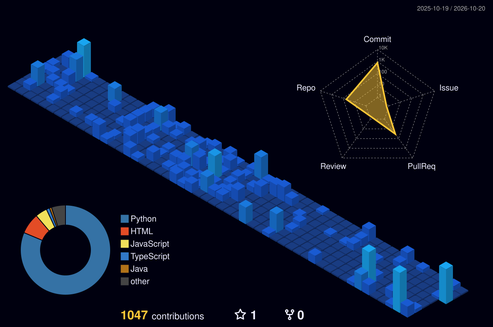
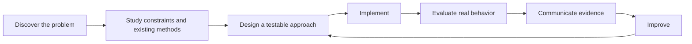

# Adishree Gupta
### Software Engineer · AI/ML Engineer · Research Engineer · Full-Stack Builder · Security & Data Systems

**I build across disciplines — from algorithms and APIs to intelligent systems, visual applications, cybersecurity and products people can use.**

[Explore 104 public repositories](docs/PROJECT_DIRECTORY.md) · [Find my work by role](docs/ROLE_PATHWAYS.md) · [Google Scholar](https://scholar.google.com/citations?user=NAn0PqcAAAAJ&hl=en) · [LinkedIn](https://www.linkedin.com/in/adishreegupta/) · [Email](mailto:adishreegupta@gmail.com)

---

## Welcome to my engineering city

Each building represents a different discipline. The animated skyline grows from the ground up; the engineering behind my work is explored through the repository links below.

I'm a **B.Tech Computer Science student at PES University, Bengaluru**, interested in solving practical problems through software, experimentation, research and product thinking. I work across multiple technical areas rather than presenting one project as my entire identity.

### Which engineer am I?

| Engineering identity | What you'll find in my work | Project entry point |
|---|---|---|
| **Software Engineer / SDE** | Implementation, interfaces, system design, algorithmic thinking | [JourneyMind](https://github.com/1stsimplifycode/JourneyMind) |
| **Full-Stack Developer** | User interfaces connected to APIs and data services | [ClearCare](https://github.com/1stsimplifycode/ClearCare-Understand-My-Care-Instructions) |
| **Backend & API Developer** | Service logic, data processing and integrations | [Identity Threat Detection](https://github.com/1stsimplifycode/identity-threat-detection-platform) |
| **Machine Learning Engineer** | Candidate generation, matching, model evaluation | [Amazon ML](https://github.com/1stsimplifycode/Amazon-ML) |
| **Data Scientist** | Forecasting, experimental analysis, data quality | [Rice Production Forecasting](https://github.com/1stsimplifycode/Rice_Production_Forecasting_India) |
| **Computer Vision Developer** | Webcam interaction, image understanding, gesture tracking | [CamSketch](https://github.com/1stsimplifycode/CamSketch) |
| **Cybersecurity Engineer / Researcher** | Attack simulation, detection and evaluation workflows | [Identity Threat Detection Platform](https://github.com/1stsimplifycode/identity-threat-detection-platform) |
| **Cloud / DevOps Practitioner** | Deployment configurations, cloud coursework and infrastructure | [Cloud Computing Projects](https://github.com/1stsimplifycode/PES1UG23CS024_CLOUD_COMPUTING) |
| **Applied Research Engineer** | Reproducible experiments, assumptions and technical evidence | [AEGIS Multimodal](https://github.com/1stsimplifycode/AEGIS_MULTIMODAL) |
| **Technical Product Builder** | Translating complex needs into understandable applications | [JourneyMind](https://github.com/1stsimplifycode/JourneyMind) |
| **Mobile / App Development** | Mobile-oriented prototypes and interfaces | [GreenPlate Express](https://github.com/1stsimplifycode/GreenPlate-Express) |
| **Accessibility-focused Developer** | Interfaces that reduce barriers to everyday tasks | [ClearCare](https://github.com/1stsimplifycode/ClearCare-Understand-My-Care-Instructions) |

These describe fields reflected in my work, not interchangeable claims of expert seniority or professional job titles.

---

## Explore six different project worlds

### 🚆 01 / JourneyMind — Mobility & Decision Systems
**The challenge:** the cheapest advertised ride may not be the cheapest journey after booking failures and cancellations.  
**The engineering:** route alternatives, reliability-adjusted expected cost, booking simulations and transparent data assumptions.  
**Start:** [Project README](https://github.com/1stsimplifycode/JourneyMind#readme) · [Architecture](https://github.com/1stsimplifycode/JourneyMind/blob/main/ARCHITECTURE.md) · [Evaluation](https://github.com/1stsimplifycode/JourneyMind/blob/main/EVALUATION.md)

### 🧬 02 / Amazon ML — Large-Scale Entity Resolution
**The challenge:** link noisy business records from independent sources without shared identifiers.  
**The engineering:** blocking, candidate-pair matching, precision-aware evaluation and documented data forensics.  
**Start:** [Guided README](https://github.com/1stsimplifycode/Amazon-ML#readme) · [Data inventory](https://github.com/1stsimplifycode/Amazon-ML/blob/main/00_DATASET_INVENTORY.md) · [Code](https://github.com/1stsimplifycode/Amazon-ML/tree/main/code)

### 🩺 03 / ClearCare — Human-Centered Health Technology
**The challenge:** discharge instructions can be confusing; ambiguity must not be converted into medical certainty.  
**The engineering:** local text-PDF extraction, source-linked instructions, synthetic scenarios and explanation workflows.  
**Start:** [Run instructions](https://github.com/1stsimplifycode/ClearCare-Understand-My-Care-Instructions#readme) · [Architecture](https://github.com/1stsimplifycode/ClearCare-Understand-My-Care-Instructions/blob/main/ARCHITECTURE.md)  
*Research/demo scope; not medical advice.*

### 🛡️ 04 / Identity Threat Detection — Cybersecurity
**The challenge:** compare methods for detecting suspicious authentication behavior.  
**The engineering:** synthetic attack-event generation, baselines, threat detection and evaluation.  
**Start:** [Technical repository](https://github.com/1stsimplifycode/identity-threat-detection-platform)  
*Synthetic-data benchmarking does not establish real enterprise deployment performance.*

### ✋ 05 / CamSketch — Computer Vision & Human–Computer Interaction
**The challenge:** draw without a mouse or touchscreen.  
**The engineering:** webcam-based hand landmarks and gesture-triggered drawing/erasing using Python, OpenCV and MediaPipe.  
**Start:** [Project source](https://github.com/1stsimplifycode/CamSketch)

### 📡 06 / AEGIS Multimodal — Computer Vision, Media & Evidence
**The challenge:** independently check what financial broadcasts claim against external market evidence.  
**The engineering:** visual and audio evidence extraction, time alignment and explicit PASS/FAIL/ABSTAIN checks.  
**Start:** [Technical README](https://github.com/1stsimplifycode/AEGIS_MULTIMODAL#readme) · [Encoders](https://github.com/1stsimplifycode/AEGIS_MULTIMODAL/tree/main/encoders) · [Tests](https://github.com/1stsimplifycode/AEGIS_MULTIMODAL/tree/main/tests)

**[Browse other projects — agriculture, sustainability, full-stack, developer tools, data science, cloud and more →](docs/PROJECT_DIRECTORY.md)**

---

## Your real 3D GitHub skyline

This is an **actual generated contribution visualization**, not a mock-up. The animated growing buildings at the top are a separate piece of portfolio artwork.

---

## How I approach engineering

My work tends to connect **problem framing, experimental thinking and building a usable system**. Examples: JourneyMind distinguishes advertised price from expected cost; ClearCare avoids filling in ambiguous care instructions; Amazon ML documents data and evaluation assumptions; and identity detection explicitly describes its synthetic-data limits.

## Technical toolkit

**Languages:** Python · JavaScript · Java · C++ · SQL  
**Frontend & backend:** React · Node.js · Express · REST APIs · MongoDB  
**AI / ML / vision:** scikit-learn · TensorFlow · OpenCV · MediaPipe  
**Security & systems:** Linux · TCP/IP · Snort · Wazuh · network analysis  
**Development:** Git · Docker · GitHub Actions · cloud/deployment tooling

## Research, recognition & contact

My research interests include multimodal intelligence, trustworthy evidence, systems evaluation and security analytics. [Google Scholar](https://scholar.google.com/citations?user=NAn0PqcAAAAJ&hl=en) contains the bibliographic record.

My previously documented recognition includes the **National Girls Hackathon runner-up**, **TechGig Geek Goddess AIR 113**, **SBI Youth Ideathon Top 1000**, **EY GDS Certificate of Merit** and **GHCI Advancing Inclusion Scholar**.

### Discover more

[**Public project directory**](docs/PROJECT_DIRECTORY.md) · [**Role-specific engineering evidence**](docs/ROLE_PATHWAYS.md) · [**Project walkthroughs**](docs/PROJECT_SPOTLIGHTS.md)

**Building across boundaries. Explaining the engineering. Showing the evidence.**

[LinkedIn](https://www.linkedin.com/in/adishreegupta/) · [Scholar](https://scholar.google.com/citations?user=NAn0PqcAAAAJ&hl=en) · [Email](mailto:adishreegupta@gmail.com)

