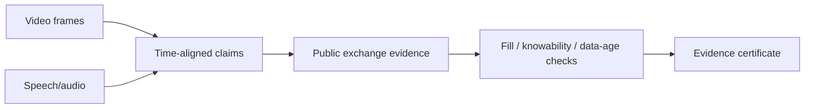
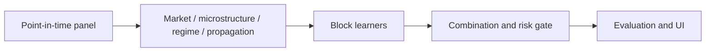
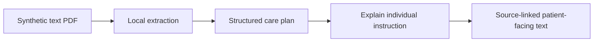
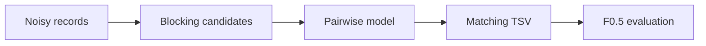

# Guided Project Walkthroughs

*This guide is a map to real source and original README explanations. Commands below are quoted from repository documentation; they were not freshly executed in this audit.*

## 01 — AEGIS Multimodal / Market Evidence Verification

**The problem:** A financial broadcast can show or describe trading claims that are difficult to independently substantiate.

**What the repository says it implements:** Frame extraction, audio text, market-time claim construction, checks against a public exchange tape and three verdict states: **PASS / FAIL / ABSTAIN**.

**System flow**

**Where to inspect:** [Encoders](https://github.com/1stsimplifycode/AEGIS_MULTIMODAL/tree/main/encoders) · [Backend](https://github.com/1stsimplifycode/AEGIS_MULTIMODAL/tree/main/backend) · [Tests](https://github.com/1stsimplifycode/AEGIS_MULTIMODAL/tree/main/tests) · [Original README](https://github.com/1stsimplifycode/AEGIS_MULTIMODAL#readme)

**Documented local commands:** `pip install -r requirements.txt` then `uvicorn backend.app:app --port 8000`. Its README also specifies `python -m pytest -q` and browser/experiment scripts.

**Key caveat:** A PASS is not proof of an authentic trade or its owner. The original project describes explicit timing and venue assumptions.

## 02 — AEGIS Statistics / Evaluate Before Trusting

**The problem:** Market-risk metrics can appear persuasive even when measured against a different data version.

**What exists:** A Python research pipeline, a lightweight backend for live runs and a Next.js visualization interface.

**Inspect:** [Research](https://github.com/1stsimplifycode/CAPSTONE-PW26_SSS_08/tree/main/research) · [Backend](https://github.com/1stsimplifycode/CAPSTONE-PW26_SSS_08/tree/main/backend) · [Next.js app](https://github.com/1stsimplifycode/CAPSTONE-PW26_SSS_08/tree/main/app) · [README](https://github.com/1stsimplifycode/CAPSTONE-PW26_SSS_08#readme)

**Critical provenance notice:** The README warns that several stored results came from an earlier 119-column panel and were not recomputed for the current 50-column version. Re-run before citing results.

## 03 — ClearCare / Explain Without Guessing

**The problem:** After medical treatment, written discharge instructions can be hard to interpret, while wrong assumptions can be dangerous.

**What exists:** Local text-PDF extraction, synthetic patient scenarios, schema-validated care plans and an instruction-specific explanation action with an AMD integration path.

**Documented try-it path:** Clone project → `npm start` → open `http://localhost:4174` → choose a synthetic scenario or text PDF. The README explains that image-only/scanned PDFs are not generally supported and that mocked automated tests do not prove a live AMD response.

**Inspect:** [Project README](https://github.com/1stsimplifycode/ClearCare-Understand-My-Care-Instructions#readme) · [Architecture](https://github.com/1stsimplifycode/ClearCare-Understand-My-Care-Instructions/blob/main/ARCHITECTURE.md) · [Test documentation](https://github.com/1stsimplifycode/ClearCare-Understand-My-Care-Instructions/blob/main/CLEARCARE_TEST_RESULTS.md)

**Important:** Synthetic research/demo system; not medical advice.

## 04 — JourneyMind / The Real Cost of a Ride

**The problem:** A low advertised price can become expensive after unsuccessful booking attempts or cancellation.

**What the repository describes:** Door-to-door mobility options, reliability-adjusted expected cost, a demonstrator booking simulator and data provenance labels.

**Walkthrough:** Start the demo → compare mode/price → attempt a booking → observe retries/outcome → open modeled expected-cost explanation.

**Documented Windows command:** `run-demo.bat`.

**Inspect:** [README](https://github.com/1stsimplifycode/JourneyMind#readme) · [Architecture](https://github.com/1stsimplifycode/JourneyMind/blob/main/ARCHITECTURE.md) · [Evaluation](https://github.com/1stsimplifycode/JourneyMind/blob/main/EVALUATION.md)

**Limits:** The project says hailed-vehicle quotes and booking outcomes are modeled, not connected to live provider booking APIs.

## 05 — Amazon ML / Entity Resolution

**The problem:** Link business records with noisy names and addresses across three sources while reducing false merges.

**Approach documented in repository:** Data inventory → blocking candidate pairs → match scoring → precision-weighted F0.5 evaluation → TSV deliverables.

**Inspect:** [Source code](https://github.com/1stsimplifycode/Amazon-ML/tree/main/code) · [Dataset inventory](https://github.com/1stsimplifycode/Amazon-ML/blob/main/00_DATASET_INVENTORY.md) · [Experiment ledger](https://github.com/1stsimplifycode/Amazon-ML/blob/main/EXPERIMENT_LEDGER.md).

**Reproducibility requirement:** Original datasets must be lawfully available locally. Do not claim evaluation or ranking without opening source artifacts and running the specified process.

## 06 — AEGIS Market / Multimodal Market Intelligence

**The goal:** Organize multiple market-evidence channels into an interpretable risk narrative.

**Explore:** [Application repository](https://github.com/1stsimplifycode/AEGIS-MARKET), [related capstone evidence](https://github.com/1stsimplifycode/CAPSTONE-PW26_SSS_08), and [multimodal video-evidence implementation](https://github.com/1stsimplifycode/AEGIS_MULTIMODAL).

**Boundary:** These repositories are related but are not interchangeable implementations. Follow each repository's individual README for its actual capabilities.

---

## How to use the spotlights

Each spotlight tells you **the problem, observed design, primary entry point, reproduction path when documented, and an important limitation**. For an engineering review, follow the source and execute the documented steps; the descriptions here are not substitute evidence for successful runtime tests.
